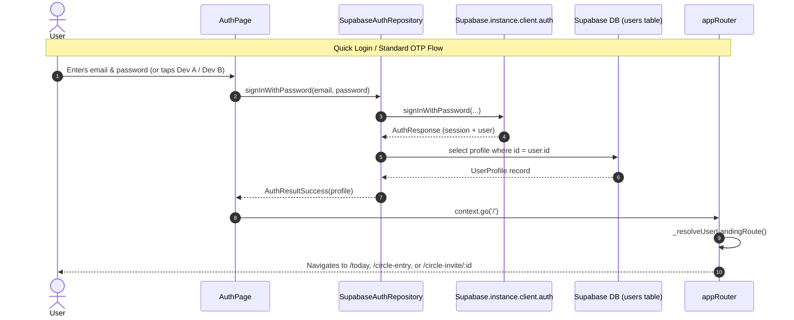
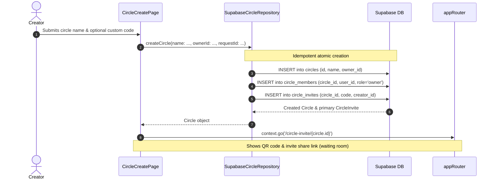
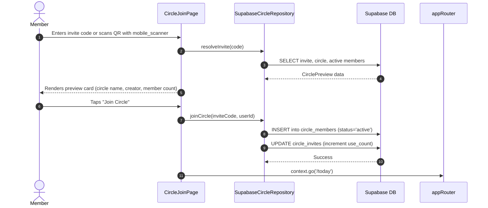
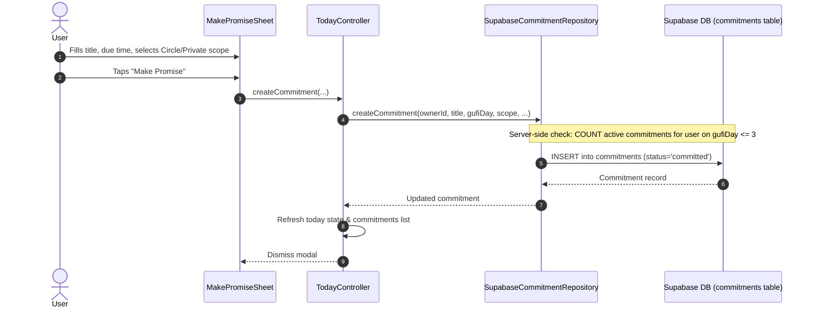
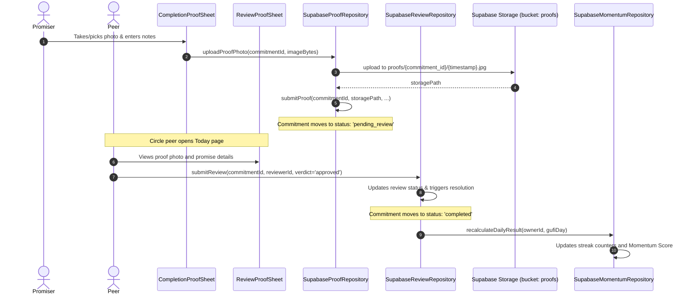

# Gufi Data Flow Architecture

> **Data Flow Maps for Core Operations**
> Tracing UI interactions through Repositories, Supabase RPCs, and State Controllers.

---

## 1. Authentication & Session Restore Flow

---

## 2. Circle Creation Flow

---

## 3. Circle Join Flow (Code / QR Scanner)

---

## 4. Daily Promise Creation Flow (Atomic 3-Limit Enforcement)

---

## 5. Proof Submission & Peer Review Loop

