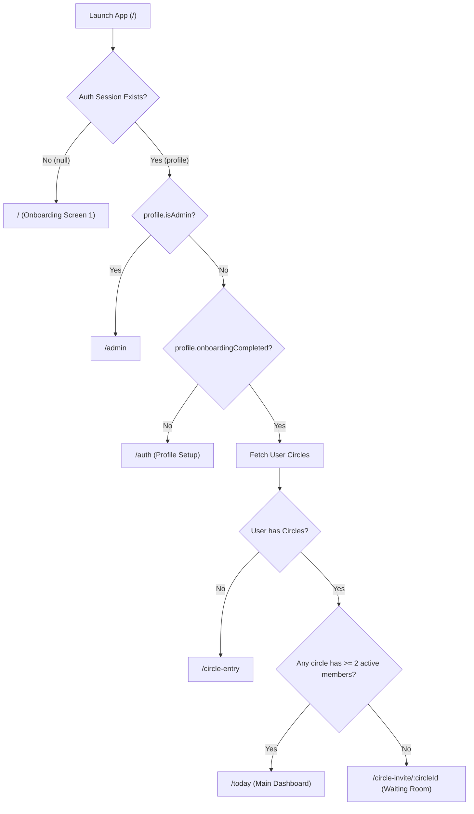

# Gufi Route Map

> **Complete Specification of `lib/app/router.dart`**
> Documenting the actual navigation graph, guard logic, entry conditions, and redirection rules.

---

## 1. Startup & Session Landing Rules (`_resolveUserLandingRoute`)

When the application boots or navigates to `/`, the root redirect guard queries the session:

---

## 2. Route Registry

### `/` (Root Entry)
* **Target Widget:** `OnboardingPage`
* **Entry Condition:** Unauthenticated cold launch landing.
* **Redirect Behavior:**
  * If unauthenticated: stays on `/` rendering `OnboardingPage` starting at screen 1.
  * If authenticated: redirects immediately via `_resolveUserLandingRoute()`.

### `/bootstrap`
* **Target Widget:** `BootstrapScreen`
* **Entry Condition:** Explicit fallback route during async state recovery.

### `/onboarding`
* **Target Widget:** `OnboardingPage`
* **Entry Condition:** Public onboarding carousel.
* **Origin:** Direct navigation or user restart of onboarding.

### `/auth`
* **Target Widget:** `AuthPage`
* **Transition:** Custom slide transition (`Duration: 190ms`, curve: `Curves.easeOutCubic`).
* **Entry Condition:** User clicks "Get Started" from onboarding or has an incomplete profile.
* **Origin:** `OnboardingPage`, root redirect guard.

### `/circle-entry`
* **Target Widget:** `CircleEntryPage`
* **Entry Condition:** Authenticated user with completed profile but no active circle memberships.
* **Origin:** Root redirect guard, or clicking circle options.

### `/circle-create`
* **Target Widget:** `CircleCreatePage`
* **Entry Condition:** User initiating creation of a new accountability circle.
* **Origin:** `CircleEntryPage` ("Create a Circle" button).

### `/circle-join`
* **Target Widget:** `CircleJoinPage`
* **Query Parameters:** `?code=GUFI-XXXXXX` (optional invite code from deep link or QR scan).
* **Entry Condition:** User entering invite code or scanning invite QR code.
* **Origin:** `CircleEntryPage` ("Join a Circle" button), deep links (`gufi://join?code=...`).

### `/circle-invite/:id`
* **Target Widget:** `CircleInvitePage`
* **Path Parameters:** `:id` (Circle ID).
* **Entry Condition:** Circle creator whose circle currently has fewer than 2 active members (waiting room until peers join).
* **Origin:** Root redirect guard, or immediately following `CircleCreatePage` completion.

### `/today`
* **Target Widget:** `TodayPage`
* **Entry Condition:** Authenticated user with completed profile belonging to at least one circle with $\ge 2$ active members.
* **Origin:** Root redirect guard, or when a second member joins a circle.

### `/admin`
* **Target Widget:** `AdminDashboardPage`
* **Entry Condition:** User profile has `role == 'admin'`.
* **Origin:** Root redirect guard.

### `/admin/database`
* **Target Widget:** `AdminDatabaseGridPage`
* **Entry Condition:** Admin inspecting live Supabase tables and exporting CSVs.
* **Origin:** `AdminDashboardPage` top navigation action.
